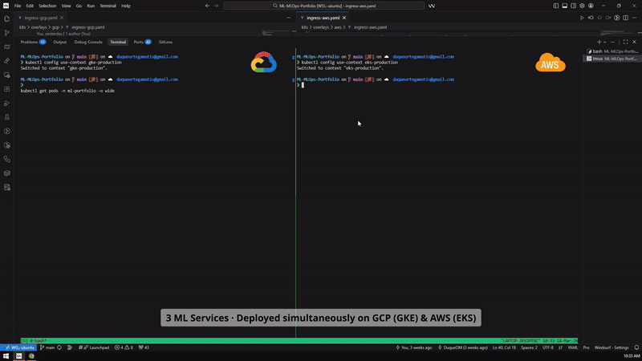

# Projects

<canvas data-neural-scene="helm" aria-hidden="true"></canvas>
Projects · what I built and how

# ML services in production, an LLM agent, and architecture studies

Three ML services I deployed to GKE and EKS, with the production problems I
found and fixed; a WhatsApp customer-service agent, in progress; `read_aloud`, a
text-to-speech app I use every day; and three architecture studies. I design the
system and make the decisions; I use AI coding agents (Claude Code) for speed.
Each section says which parts the agents wrote.

[ML-MLOps Portfolio](#the-ml-mlops-portfolio){ .portfolio-button .portfolio-button--primary }
[WhatsApp agent](#whatsapp-customer-service-agent){ .portfolio-button }
[read_aloud](#read_aloud){ .portfolio-button }
[Architecture studies](#architecture-studies){ .portfolio-button }

## The ML-MLOps Portfolio

The portfolio is not three models — it is one production system that happens
to serve three of them. Each service ships with its FastAPI contract, test
suite, Docker image and Kubernetes manifests; around them sits the shared
MLOps surface: Terraform-provisioned GKE and EKS clusters, Kustomize overlays
per environment, GitHub Actions CI/CD with quality gates, MLflow tracking,
Prometheus + Grafana monitoring, and the incident write-ups. Deployed to GKE
and EKS in March 2026, then shut down to save costs. I designed the
architecture and made the decisions; AI coding agents helped me build it faster.

395+ automated tests and 18 architecture decision records hold it together —
every non-trivial choice is documented with the alternatives it rejected.

<strong>How to review it</strong>

Pick one service and follow its evidence chain: metrics → serving path →
deployment → incident. The debugging deep dive on BankChurn is the
strongest 10-minute read.

The three services inside the portfolio — each with its own deep-dive page.
Hover to hold, drag to browse, or click a card to bring it to center:

<small>churn classification</small>
<h3>BankChurn Predictor</h3>

AUC 0.87
90% coverage
FastAPI · K8s · SHAP

Cost-aware churn classification — and the serving incident that went from
81% errors to 0% at half the CPU.

[BankChurn Predictor](bankchurn.md){ .portfolio-button }

<small>financial nlp</small>
<h3>NLPInsight Analyzer</h3>

80.6% accuracy
98% coverage
CPU-only serving

Financial sentiment with an explainable, low-cost inference path — the
heavier transformer documented as a rejected trade-off.

[NLPInsight Analyzer](nlpinsight.md){ .portfolio-button }

<small>demand forecasting</small>
<h3>ChicagoTaxi Pipeline</h3>

R² 0.96
6.3M rows
PySpark · temporal CV

Demand forecasting at scale with strictly temporal validation — and the
data leak that was caught before the metrics were published.

[ChicagoTaxi Pipeline](chicagotaxi.md){ .portfolio-button }

All the infrastructure, testing, security and monitoring proof behind the
portfolio lives in one place:

[:fontawesome-solid-flask: Evidence](../technical-evidence.md){ .portfolio-button .portfolio-button--primary }
[:fontawesome-solid-cloud: Deployment](../DEPLOYMENT_EVIDENCE.md){ .portfolio-button }
[:fontawesome-solid-circle-check: Status](../DEPLOYMENT_EVIDENCE.md){ .portfolio-button }
[:fontawesome-solid-diagram-project: ADRs](../architecture/decisions.md){ .portfolio-button }
[:fontawesome-brands-github: Repository](https://github.com/DuqueOM/ML-MLOps-Portfolio){ .portfolio-button }

## WhatsApp customer-service agent

A WhatsApp customer-service agent for a small business, **in progress**. Built
with PHP 8.3 and MySQL on the Meta Cloud API: webhooks with signature
validation, idempotent message storage, LLM tool calling so the agent can look
up real data, human handoff when the bot should not answer, and evals to
measure the answers.

I wrote the spec and the plan, and I write the core logic. AI agents generate
the scaffolding, which I review personally. First release planned for January
2027.

<strong>Why this project</strong>

It has the same shape as real junior AI engineer work: an LLM inside a
product, with tools, a human in the loop and a way to measure quality.

[:fontawesome-brands-github: agent-whatsapp-php](https://github.com/DuqueOM/agent-whatsapp-php){ .portfolio-button .portfolio-button--primary }

## read_aloud

A Windows text-to-speech app **I use every day**. It reads selected text aloud
with local neural voices (Piper, Qwen3-TTS), in Spanish and English in the same
text, offline.

I fine-tuned a Qwen3-TTS voice with LoRA on my own GPU (RTX 5070, 8 GB). I
chose the training setup and the final epoch, and used WavLM to compare the
voices. 15 ADRs record the decisions. Built with AI coding agents.

<strong>What to look at</strong>

The ADRs on the LoRA training and the epoch choice, and how WavLM compares
voices.

[:fontawesome-brands-github: read_aloud](https://github.com/DuqueOM/read_aloud){ .portfolio-button .portfolio-button--primary }

## Architecture studies

<strong>Designed and directed by me · not deployed to a cloud</strong>

Larger systems I designed and directed. AI coding agents wrote most of the
code. Not deployed to a cloud. They show how I plan a system: separate
repositories with written contracts between them, scope limits written down as
decisions, and claims tied to tests that can fail a build.

### ml-service-template

The first study is what the ML services taught: a starter template that
encodes their production lessons as reusable defaults.
Scaffold a new ML service and it arrives with the serving and training
patterns, deployment overlays and operating guardrails already in place —
the mistakes the portfolio paid for once, prevented by default.

Inside the box: a FastAPI serving scaffold with the single-worker +
ThreadPoolExecutor pattern, training pipelines with quality gates (metric,
fairness, leakage), 6 env×cloud Kustomize overlays for GCP and AWS,
Terraform modules, CI/CD that signs images and attests SBOMs (SLSA L2),
closed-loop drift monitoring, 38 documented anti-patterns and 52 ADRs.

Its differentiator is the **governed AI-assisted development layer**:
behavior rules, skills, workflows and an audit trail that keep agentic
coding reviewable and bounded — engineered, not hidden.

Its **scope limit is itself an ADR**: classical ML only, single team, 1–5
models, small-team calibration — "2–3 models → CronJob, not Airflow". LLM/GenAI,
feature stores and data contracts are deferred there *by decision*, each with a
revisit trigger. That limit is why `ml-platform` is a separate study.

<strong>Why it matters</strong>

The ML services are where the lessons came from. The template is my design for
turning those lessons into defaults for the next service.

[Open the template page](../template.md){ .portfolio-button .portfolio-button--primary }
[:fontawesome-brands-github: Repository](https://github.com/DuqueOM/ml-service-template){ .portfolio-button }

### ml-platform

This study exists **because the template's scope limits were correct**.
A single-service scaffold cannot hold point-in-time feature retrieval,
lakehouse table formats with schema evolution, orchestration with lineage,
GitOps reconciliation, LLM systems with evaluation gates, or governance
artifacts written for an auditor. All of that presumes a platform several
projects share — so it got its own repository instead of widening the first.

`ml-platform` is the second template: a multi-project
monorepo whose unit of reuse is a *library plus a running service*, not a
scaffold you copy out. Projects span tabular ML, time series, deep learning,
LLM/RAG and agents — diversity is the point, because a substrate that serves
one problem shape has not been shown to be a substrate. It **consumes**
`ml-service-template` through `copier` and is forbidden from reimplementing
it: where the two disagree on serving, the template wins (ADR-003).

Inside: Apache Iceberg with BigLake / S3 Tables, DuckDB + Polars and dbt;
point-in-time joins with a leakage detector; Airflow 3 + KFP v2 into Vertex AI
and SageMaker Pipelines; ArgoCD with ApplicationSets and Argo Rollouts;
OpenTelemetry into Grafana LGTM; LiteLLM with a prompt registry, semantic
cache, guardrails and promptfoo eval gates; LoRA/PEFT for the document track;
and four drift detectors for four project kinds on one shared contract.

<strong>What it shows</strong>

Scope discipline: two templates exist because one of them said no — and the
boundary is written down as a decision, not left to taste.

<strong>What it does not claim</strong>

Build state is generated from the filesystem, never hand-maintained:
<strong>51 done · 3 partial · 11 absent</strong> of 65 tracked components, with
<strong>39 proven at L1</strong> (the suite passes) and <strong>12 at L2</strong>
(the thing executes). <strong>L4 — a real rollout on GKE or EKS — is printed at
zero</strong>, because none has happened. The taxonomy exists because six
Kubernetes overlays once rendered green for weeks while their probes pointed at
routes the service does not serve. A suite passing and a pod answering are not
the same claim.

[Open the ml-platform page](../ml-platform.md){ .portfolio-button .portfolio-button--primary }
[:fontawesome-brands-github: Repository](https://github.com/DuqueOM/ml-platform){ .portfolio-button }
[:fontawesome-solid-scale-balanced: Charter — what it refuses to be](https://github.com/DuqueOM/ml-platform/blob/main/docs/decisions/ADR-000-charter-and-scope.md){ .portfolio-button }
[:fontawesome-solid-circle-check: Implementation status](https://github.com/DuqueOM/ml-platform/blob/main/docs/architecture/implementation-status.md){ .portfolio-button }

### agent-local

This study takes the template's governance philosophy — `AUTO / CONSULT
/ STOP`, eval-gated autonomy, policy-as-data, no fine-tuning until a written
gate fires — and **generalizes it to a new domain**: local, multi-tier LLM
agents. The hard-won logic (grammar-constrained routing, an adaptive reasoning
loop, objective escalation, a deterministic policy gate) lives in a reusable
`core/`; a new domain is a thin `usecases/<name>/` folder, never a fork.

The shipped example use-case is a WhatsApp store assistant — but the point is
the platform, not the store.

**This core is also the LLM plane inside `ml-platform`.** `ml-platform` vendored
it in with its full git history (ADR-002): `core/` became `libs/llm-core/`,
the `tienda` use-case became `projects/store-assistant/`. The standalone
repository stays live because the two are not the same value — the platform
gives this core one particular, governed use, while `agent-local` is the
standalone version of that core, for anyone who wants it by itself. The core
itself is developed in `ml-platform`.

<strong>What it shows</strong>

The same governance rules carried over to a different domain (LLM agents), and
then moved into a platform without being rewritten.

The status below tracks against the published plan
([`ACTION_PLAN_LLM_AGENT.md`](https://github.com/DuqueOM/ml-service-template/blob/main/docs/audit/ACTION_PLAN_LLM_AGENT.md))
— ✅ done · 🔨 in progress · ⏳ gated/next.

<small>✅ Phase 0–1 · foundation</small>
<h3>Runtime, router & policy gate</h3>
<ul>
<li>✅ llama.cpp bench + tier contract (E4B router gate <strong>20/20</strong>)</li>
<li>✅ grammar-constrained routing with confidence</li>
<li>✅ reusable <code>core/</code> + thin <code>usecases/</code> (ADR-001)</li>
<li>✅ deterministic policy gate; all tools read-only</li>
</ul>

<small>✅ Phase 2 · controller & verifier</small>
<h3>Governed execution</h3>
<ul>
<li>✅ ExecutiveController + per-tier circuit breaker</li>
<li>✅ policies as versioned YAML + <code>decision_id</code></li>
<li>✅ cross-tier verifier + bounded self-consistency, reflection notes isolated from evidence (ADR-009)</li>
<li>✅ 11 evaluation sets (incl. adversarial injection) + offline gate</li>
</ul>

<small>🔨 Phase 3 · observability</small>
<h3>Telemetry & learning loop</h3>
<ul>
<li>✅ decision telemetry contract + PII redaction</li>
<li>✅ shadow sampling</li>
<li>🔨 retrieval growth loop (alias mining from logs)</li>
<li>🔨 golden set + replay against real traffic</li>
</ul>

<small>⏳ Phase 4 · gated / next</small>
<h3>Scale & adapt</h3>
<ul>
<li>⏳ SQLite queue + sagas (durable multi-day flows)</li>
<li>⏳ live WhatsApp webhook + cloud overflow path</li>
<li>⏳ comparative experiment vs portfolio datasets</li>
<li>⏳ QLoRA / DPO — only when the written gate fires</li>
</ul>

[:fontawesome-solid-diagram-project: The agent-local page](../agent-local.md){ .portfolio-button .portfolio-button--primary }
[:fontawesome-brands-github: Repository](https://github.com/DuqueOM/agent-local){ .portfolio-button }
[:fontawesome-solid-diagram-project: The shared plan](https://github.com/DuqueOM/ml-service-template/blob/main/docs/audit/ACTION_PLAN_LLM_AGENT.md){ .portfolio-button }
[:fontawesome-solid-scale-balanced: Why a platform (ADR-001)](https://github.com/DuqueOM/agent-local/blob/main/docs/decisions/ADR-001-reusable-platform-not-template.md){ .portfolio-button }
[:fontawesome-solid-shield-halved: Why not MCP/A2A (ADR-010)](https://github.com/DuqueOM/agent-local/blob/main/docs/decisions/ADR-010-mcp-a2a-interop-rejected.md){ .portfolio-button }

 

